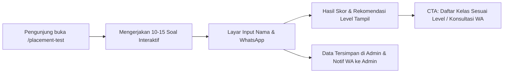

# 🚀 Roadmap & Ide Fitur Baru — LPK Mega Guna Talent

Dokumen ini merangkum analisis strategis dan rekomendasi fitur baru untuk platform web **LPK Mega Guna Talent (Kursus Bahasa Jerman & Program Ausbildung Jerman)**. Fitur-fitur ini dirancang khusus untuk meningkatkan **konversi pendaftaran (lead generation)**, **kepercayaan calon siswa/orang tua (trust & social proof)**, serta kemudahan operasional tim admin.

---

## 📌 Ringkasan Prioritas Fitur

| No | Fitur | Kategori | Prioritas | Estimasi Impact |
|---|---|---|---|---|
| 1 | **Online German Placement Test** (Tes Level Interaktif + Lead Magnet) | Lead Gen & Edukasi | 🔥 High (P1) | 🚀 Konversi Leads +80% |
| 2 | **Kalkulator Biaya Hidup & Gaji Ausbildung Jerman** (Simulasi Finansial) | Interaktif & Trust | 🔥 High (P1) | 💡 Viralitas & Time-on-Site |
| 3 | **Alumni Stories & Visa Wall Gallery** (Social Proof & Testimoni) | Branding & Trust | ⚡ Medium (P2) | 🏆 Keyakinan Orang Tua & Calon Siswa |
| 4 | **Jadwal Batch Kelas & Tracker Sisa Kuota** (Urgensi / FOMO) | Pendaftaran | ⚡ Medium (P2) | ⏰ Mempercepat Closing Pendaftaran |
| 5 | **WhatsApp Gateway Integration** (Notifikasi Otomatis Admin & Siswa) | Otomasi Operasional | ⚡ Medium (P2) | ⚡ Respon Cepat < 1 Menit |
| 6 | **Free E-Book / Guidebook Downloader** (Lead Capture Magnet) | Marketing | 🌿 Normal (P3) | 📥 Database Prospek Jangka Panjang |
| 7 | **Student Portal & E-Learning Preview** | Akademik | 🌿 Future (P4) | 🎓 Nilai Tambah Layanan Kursus |

---

## 1. 🎯 Online German Placement Test (Tes Level Jerman Interaktif)

### Latar Belakang & Masalah
Banyak calon peserta kursus yang bingung: *"Saya harus mulai dari A1 atau A2 ya? Apakah dasar bahasa Jerman saya sudah cukup?"*. Tanpa tes awal, mereka ragu untuk langsung mendaftar.

### Solusi & Konsep Fitur
Halaman kuis interaktif 10–15 soal singkat (pilihan ganda) yang menguji pemahaman Grammar, Vocabulary, dan Situational Reading dasar.

### Alur Pengguna (User Flow)

### Spesifikasi Teknis
- **Komponen Frontend**: Multi-step quiz menggunakan Alpine.js / Blade tanpa refresh halaman. Progress bar dinamis.
- **Backend / Database**:
  - Model `PlacementQuestion` & `PlacementSubmission`.
  - Scoring engine otomatis memetakan skor ke level: *Beginner A1*, *Elementary A2*, atau *Intermediate B1*.
- **Admin Panel**: Menu `/admin/placement-tests` untuk melihat data calon siswa, skor, jawaban, dan tombol langsung *Chat WhatsApp*.

---

## 2. 💶 Kalkulator Gaji & Biaya Hidup Ausbildung Jerman

### Latar Belakang & Masalah
Pertanyaan paling sering dari calon siswa dan orang tua:
- *"Di Jerman nanti dapat uang saku berapa per bulan?"*
- *"Cukup nggak untuk bayar sewa kamar dan makan?"*
- *"Bisa kirim uang atau nabung nggak?"*

### Solusi & Konsep Fitur
Kalkulator simulasi finansial real-time yang transparan dan interaktif.

### Fitur Utama
1. **Pilihan Jurusan Ausbildung**:
   - *Pflegefachkraft* (Keperawatan) — Gaji kotor: ~€1.100 - €1.300/bln
   - *Hotelfachmann/frau* (Perhotelan) — Gaji kotor: ~€900 - €1.150/bln
   - *Mechatroniker* (Teknik / Mekatronik) — Gaji kotor: ~€1.050 - €1.250/bln
2. **Pilihan Wilayah / Negara Bagian (Bundesland)**:
   - Estimasi biaya sewa kamar (WG) sesuai kota (Berlin, München, NRW, Leipzig, dll.).
3. **Output Kalkulasi Interaktif (Visual Card & Breakdown)**:
   - Gaji Kotor (Brutto)
   - Potongan Pajak & Asuransi Kesehatan (Netto)
   - Biaya Hidup (Sewa Kamar, Makan, Transport, Pulsa)
   - **Sisa Tabungan Bersih Bulanan (dalam € Euro dan Rp Rupiah)**
4. **Call to Action**: Tombol *"Konsultasikan Jalur Ausbildung Kamu Sekarang"*.

---

## 3. 🎓 Alumni Stories & Visa Wall Gallery (Kisah Sukses Alumni)

### Latar Belakang & Masalah
Bisnis LPK penyalur luar negeri sangat bergantung pada **kepercayaan**. Calon siswa dan orang tua ingin melihat bukti nyata orang-orang yang sudah sukses berangkat ke Jerman melalui LPK Mega Guna Talent.

### Fitur Utama
- **Galeri Foto & Video Alumni**: Dokumentasi alumni di Jerman (di rumah sakit, hotel, workshop pabrik, atau foto kedatangan di bandara Frankfurt).
- **Visa Wall**: Galeri foto visa resmi kerja / Ausbildung yang telah terbit (watermarked & disensor data sensitif pribadi).
- **Detail Profil Alumni**:
  - Nama, kota asal di Indonesia.
  - Penempatan kota di Jerman & perusahaan tempat Ausbildung.
  - Kutipan pengalaman belajar di Mega Guna Talent hingga lolos wawancara kerja.
- **Admin CRUD**: Kelola cerita alumni di `/admin/alumni` (tambah foto, video YouTube/TikTok embed, status aktif).

---

## 4. 📅 Jadwal Batch Kelas & Tracker Sisa Kuota (Live Batch Tracker)

### Latar Belakang & Masalah
Calon siswa sering menunda pendaftaran karena tidak ada rasa urgensi.

### Fitur Utama
- **Display Jadwal Kelas Terdekat**:
  - Contoh: *Batch Mei 2026 — Kelas Intensif A1 (Pagi)*.
  - Tanggal Mulai & Durasi (e.g. 12 Mei - 30 Juni 2026).
  - Hari & Jam Pelaksanaan (Senin - Jumat, 09.00 - 13.00 WIB).
  - Mode: *Offline di Kampus LPK* / *Online Interaktif Zoom*.
- **Indicator Kuota Realtime**:
  - Progress bar kapasitas (misal: *Tersisa 4 dari 15 Kursi*).
  - Badge Status: `Pendaftaran Dibuka` (Hijau), `Hampir Penuh` (Kuning/Oranye), `Penuh` (Merah/Abu-abu).
- **Quick Enroll**: Klik langsung mengarahkan ke form pendaftaran dengan batch yang sudah terpilih otomatis.
- **Admin Control**: Pengaturan kuota dan tanggal di admin panel.

---

## 5. 📲 WhatsApp Gateway & Instant Notification System

### Latar Belakang & Masalah
Jika calon murid mendaftar di website namun baru dihubungi admin 3-5 jam kemudian, minat mereka sudah menurun drastis.

### Fitur Utama
- **Otomatis Kirim ke Calon Siswa (Auto-responder WA)**:
  > *"Halo Kak [Nama], terima kasih telah mendaftar di Program [Program] LPK Mega Guna Talent! Konsultan pendidikan kami akan segera menghubungi Kakak dalam 1x24 jam untuk panduan jadwal kelas dan persiapan dokumen. Salam hangat, Tim Mega Guna Talent."*
- **Notifikasi Instan ke HP Admin / Tim CS**:
  > *"🔥 Pendaftar Baru Masuk!*\nNama: [Nama]\nProgram: [Program]\nNo. WA: [No. HP]\nCatatan: [Catatan]"*
- **Penyedia Layanan yang Didukung**:
  - Fonnte API, Wablas, atau Twilio / Official WhatsApp Cloud API.
  - Driver fallback: Jika API sedang down / kuota habis, sistem tetap berjalan normal dan mencatat log.

---

## 6. 📖 Lead Magnet: Download Panduan Lengkap Ausbildung (E-Book)

### Fitur Utama
- Modal popup / landing banner: *"Download E-Book Gratis: Panduan Lengkap Jalur Ausbildung Jerman dari Nol Sampai Berangkat"*.
- Pengunjung memasukkan Nama, Email, dan No. WhatsApp.
- File PDF otomatis terunduh atau dikirimkan ke WhatsApp mereka.
- Tim marketing mendapatkan ratusan kontak prospek berkualitas tinggi yang siap difollow-up.

---

## 7. 💻 Student Portal & Silabus Dashboard (Fase Masa Depan)

### Fitur Utama
- Login khusus siswa aktif LPK Mega Guna Talent.
- Akses jadwal harian, link Zoom kelas online, dan download modul materi PDF per modul (A1.1, A1.2, dst.).
- Tracker absensi dan nilai try out sertifikasi Goethe-Zertifikat.

---

## 🛠️ Rekomendasi Urutan Pengerjaan (Next Steps)

1. **Sprint 1 (Quick Win & High Impact)**:
   - ➔ **Online German Placement Test** (Quiz interaktif + lead capture + admin recap).
2. **Sprint 2 (High Engagement)**:
   - ➔ **Kalkulator Gaji & Biaya Hidup Ausbildung**.
3. **Sprint 3 (Social Proof & Urgensi)**:
   - ➔ **Alumni Success Stories & Visa Gallery** + **Jadwal Batch & Kuota**.
4. **Sprint 4 (Otomasi)**:
   - ➔ **WhatsApp Notification Gateway**.

---
*Dokumen ini diperbarui secara berkala sesuai kebutuhan pengembangan platform LPK Mega Guna Talent.*
